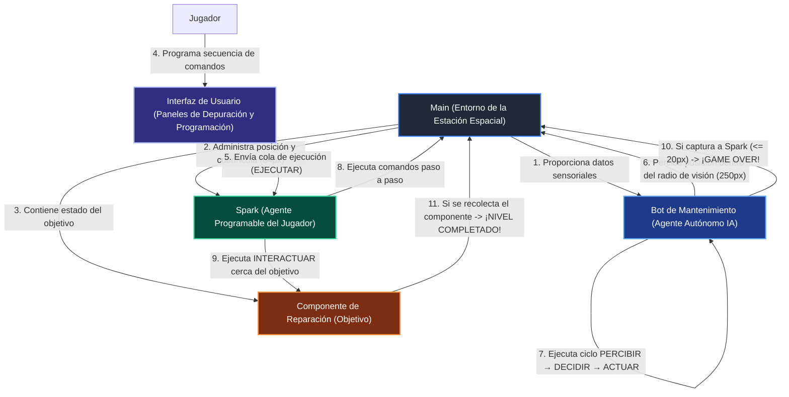
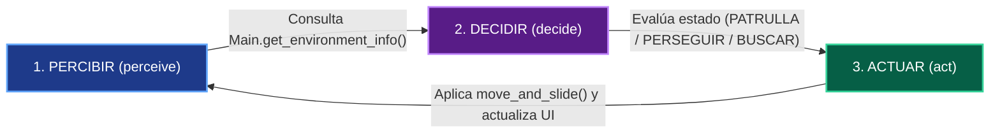
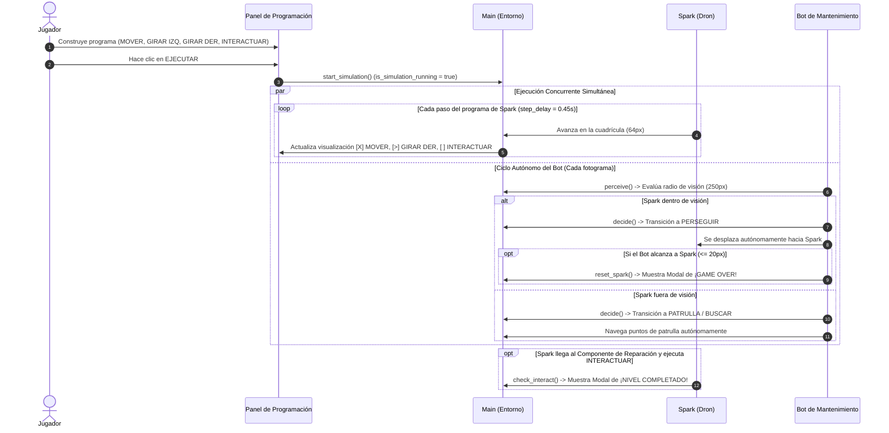
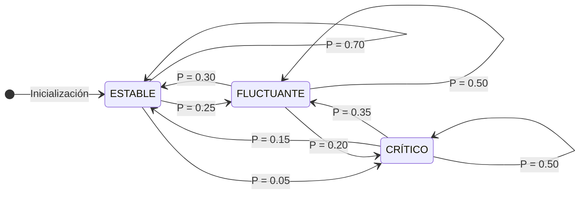
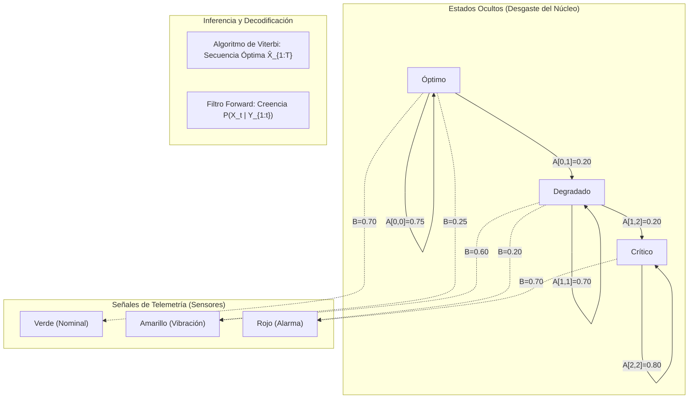
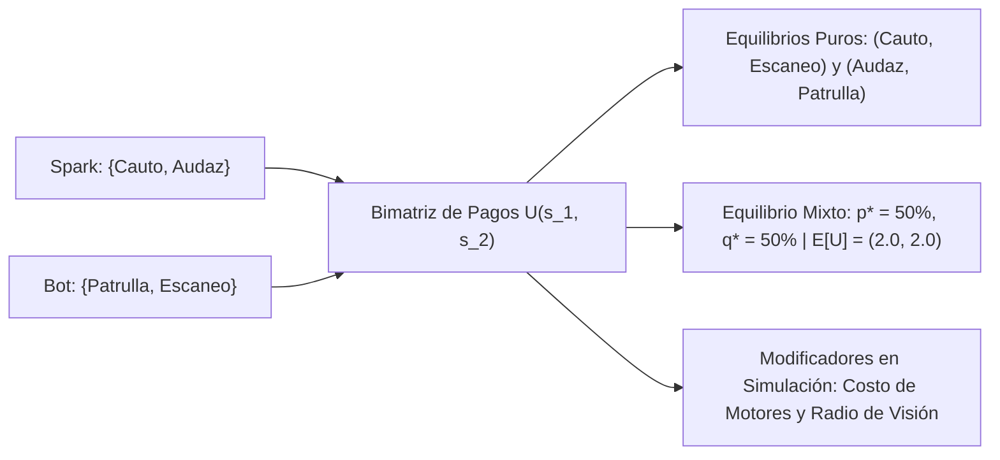

# Diagramas de Arquitectura General - Logic Loop

## 1. Arquitectura General del Sistema

## 2. Ciclo PERCIBIR → DECIDIR → ACTUAR

## 3. Diagrama de Secuencia de Ejecución

## 4. Paradigma 4: Cadenas de Markov (Clima Espacial y Radiación)

Proceso estocástico en tiempo discreto $\{X_t, t \ge 0\}$ con propiedad de Markov sobre el espacio de estados $S = \{\text{ESTABLE}, \text{FLUCTUANTE}, \text{CRÍTICO}\}$.

- **Distribución Estacionaria $\pi$**: Calculada mediante el método de potencias $\pi P = \pi \implies \pi \approx [0.453, 0.358, 0.189]$.
- **Impacto Físico**: Modula la tasa de recarga solar de Spark ($\times 1.0, \times 0.6, \times 0.2$) y la velocidad de alerta del Bot de Mantenimiento.

---

## 5. Paradigma 5: Modelos Ocultos de Markov (HMM - Diagnóstico Latente)

Tupla $\lambda = (A, B, \pi_0)$ para inferencia y filtrado sobre estados inobservables del núcleo de la estación.

---

## 6. Paradigma 6: Teoría de Juegos (Interacción Estratégica)

Juego bimatriz $2 \times 2$ entre Spark (Dron) y Bot de Mantenimiento (Seguridad).

| Spark \ Bot | Patrulla Suave (0) | Escaneo Estricto (1) |
|:---|:---:|:---:|
| **Cauto / Stealth (0)** | $(3.0, 3.0)$ | $(1.0, 4.0)$ |
| **Audaz / Rush (1)** | $(4.0, 1.0)$ | $(0.0, 0.0)$ |

