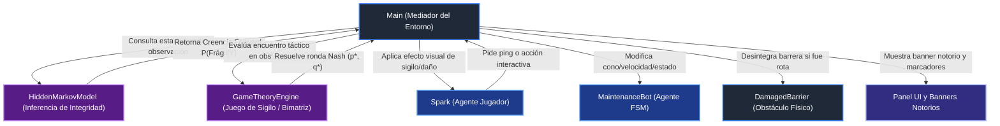

# Propuesta y Diseño Técnico: Mejoras de HMM y Teoría de Juegos
## Logic Loop — Modelos y Simulación (2026-2)

**Autor del proyecto:** Esteban  
**Fecha:** Octubre 2026  
**Contexto:** Retroalimentación del docente para integrar físicamente el Modelo Oculto de Markov (HMM) y la Teoría de Juegos al escenario interactivo mediante un **Obstáculo Físico (Barrera / Muro Destructible)** y mecánicas de **Sigilo / Cobertura**.

---

## 1. Justificación y Diagnóstico del Estado Previo

### 1.1 Estado Previo
- **HMM previo:** Modelaba el desgaste latente del núcleo de la estación espacial mediante señales de telemetría emitidas al interactuar al final del nivel. Aunque matemáticamente riguroso (Forward y Viterbi), estaba desacoplado de las decisiones espaciales del jugador.
- **Teoría de Juegos previa:** Implementaba un juego $2 \times 2$ tipo Halcón-Paloma en una pestaña UI que modificaba sutilmente el consumo de energía y el radio de visión, pero carecía de una manifestación física, táctica y visualmente evidente en el mapa.

### 1.2 Objetivo de la Mejora
1. **HMM Físico:** Introducir una barrera/muro dañada en el pasillo principal cuyo estado estructural interno ($X_t \in \{\text{FRÁGIL}, \text{INDESTRUCTIBLE}\}$) es oculto. Spark debe emitir pulsos de sondeo acústico/vibratorio ($Y_t$) e inferir probabilísticamente si el obstáculo es destructible para decidir entre **Embestir (Atajo)** o **Desviar (Ruta Larga)**.
2. **Teoría de Juegos Táctica:** El mismo obstáculo sirve de cobertura física. Se modela un juego de inspección asimétrico donde Spark decide entre **Ocultarse tras el obstáculo** o **Avanzar a máxima velocidad**, mientras el Bot de Mantenimiento decide entre **Barrido Intensivo del obstáculo** o **Patrulla Rápida de perímetro**. La bimatriz de pagos está matemáticamente sesgada a favor del Bot (la probabilidad/recompensa está en su favor), y el desenlace genera efectos visuales inmediatos y notables (silueta de camuflaje, barrido de escáner cónico, banners de estado y alarmas).

---

## 2. Paradigma 5: Modelo Oculto de Markov (HMM) del Obstáculo

### 2.1 Formalización Matemática $\lambda = (A, B, \pi_0)$

```
                 [ Estado Oculto X_t ]
                   /               \
         (Frágil / Fracturable)   (Blindado / Indestructible)
                   \               /
                    v             v
             [ Sensor de Resonancia Acústica ]
                            |
                   { Y_t = Observación }
              - Retorno Hueco / Resonante (0)
              - Retorno Ambiguo / Medio (1)
              - Retorno Sólido / Denso (2)
```

1. **Conjunto de Estados Ocultos ($S_H$):**
   $$S_H = \{X^{(0)}: \text{FRÁGIL / FRACTURABLE}, \; X^{(1)}: \text{BLINDADO / INDESTRUCTIBLE}\}$$
   - $N = 2$ estados.

2. **Alfabeto de Emisiones Observables ($V$):**
   $$V = \{Y^{(0)}: \text{ECO HUECO (Alta Resonancia)}, \; Y^{(1)}: \text{ECO AMBIGUO (Media Resonancia)}, \; Y^{(2)}: \text{ECO SÓLIDO (Baja Resonancia)}\}$$
   - $M = 3$ símbolos.

3. **Matriz de Probabilidades de Emisión ($B$):**
   Probabilidad $B_{jk} = P(Y_t = v_k \mid X_t = s_j)$:
   $$B = \begin{pmatrix} P(\text{Hueco}\mid \text{Frágil}) & P(\text{Ambiguo}\mid \text{Frágil}) & P(\text{Sólido}\mid \text{Frágil}) \\ P(\text{Hueco}\mid \text{Blindado}) & P(\text{Ambiguo}\mid \text{Blindado}) & P(\text{Sólido}\mid \text{Blindado}) \end{pmatrix} = \begin{pmatrix} 0.70 & 0.25 & 0.05 \\ 0.05 & 0.25 & 0.70 \end{pmatrix}$$
   - Si la pared es frágil, el sensor registra retorno hueco el $70\%$ de las veces.
   - Si la pared está blindada, registra retorno denso el $70\%$ de las veces.
   - Ruido de interferencia estructural: $25\%$ de señales moderadas/ambiguas.

4. **Matriz de Transición de Estados ($A$):**
   La integridad física del muro es una propiedad latente cuasi-estacionaria. Si se modela fatiga por pulsos de micro-impacto:
   $$A = \begin{pmatrix} 0.95 & 0.05 \\ 0.00 & 1.00 \end{pmatrix} \quad \text{o en reposo } A = \begin{pmatrix} 1.0 & 0.0 \\ 0.0 & 1.0 \end{pmatrix}$$

5. **Distribución Inicial ($\pi_0$):**
   Prior uniforme o basado en especificación de la estación:
   $$\pi_0 = [P(\text{Frágil}) = 0.50, \; P(\text{Blindado}) = 0.50]$$

### 2.2 Algoritmo de Inferencia: Filtrado Forward (Belief State)

A medida que Spark emite pulsos de escaneo acústico ($Y_1, Y_2, \dots, Y_t$), actualiza su vector de creencia $\alpha_t$:
$$\alpha_t(j) = P(Y_t \mid X_t = s_j) \sum_{i=1}^N \alpha_{t-1}(i) A_{ij}$$
Normalizado:
$$P(X_t = \text{FRÁGIL} \mid Y_{1:t}) = \frac{\alpha_t(\text{Frágil})}{\alpha_t(\text{Frágil}) + \alpha_t(\text{Blindado})}$$

### 2.3 Mecánica y Función de Pago de la Decisión en Juego
Spark tiene dos alternativas de navegación frente a la barrera:
1. **Acción `FRACTURAR` (Embestida con pulso de choque, costo: 1 turno/paso):**
   - **Si el muro es realmente FRÁGIL:** El muro colapsa en escombros (animación de rotura/desintegración). El camino directo queda abierto. Spark ahorra $6$ pasos de navegación y un $25\%$ de batería.
   - **Si el muro es BLINDADO / INDESTRUCTIBLE:** El impacto rebota contra el blindaje. Spark sufre un daño por choque ($-15\%$ de batería), queda aturdido $1$ segundo y el estruendo acústico alerta inmediatamente al Bot de Mantenimiento (`notify_spark_detected()`).
2. **Acción `RODEAR` (Desvío por el perímetro exterior, costo: 7 pasos):**
   - Garantiza no colisionar, pero consume $25\%$ extra de energía y obliga a atravesar el sector donde patrulla activamente el Bot.

**Regla de decisión racional:**
$$\text{Decidir FRACTURAR} \iff P(X_t = \text{FRÁGIL} \mid Y_{1:t}) \ge \theta_{\text{umbral}} \approx 0.65$$

---

## 3. Paradigma 6: Teoría de Juegos Táctica (Sigilo en Cobertura)

### 3.1 Formalización Estratégica (Juego de Inspección en Bimatriz $2 \times 2$)

El mismo obstáculo físico proporciona una zona de sombra sensorial (cobertura visual). Cuando Spark se encuentra en la encrucijada del obstáculo y el Bot se aproxima:

- **Jugador 1 (Spark):**
  - $a_1^{(0)} = \text{OCULTARSE (Stealth / Cobertura tras el obstáculo)}$: Apaga emisores y activa camuflaje térmico.
  - $a_1^{(1)} = \text{AVANZAR (Rush / Flanqueo rápido)}$: Corre por el corredor abierto hacia el objetivo.

- **Jugador 2 (Bot de Mantenimiento):**
  - $a_2^{(0)} = \text{BARRIDO INTENSIVO (Deep Sweep / Escaneo focalizado del obstáculo)}$: Apunta su haz de escaneo directo a la cobertura.
  - $a_2^{(1)} = \text{PATRULLA RÁPIDA (Fast Patrol / Cobertura perimetral)}$: Se desplaza rápidamente vigilando los corredores abiertos.

### 3.2 Bimatriz de Pagos Asimétrica (Probabilidad y Pagos a Favor del Bot)

El requerimiento del profesor especifica que **el NPC debe tener las probabilidades y recompensas a su favor**:

| Spark \ Bot | $a_2^{(0)}$: Barrido Intensivo (Sweep) | $a_2^{(1)}$: Patrulla Rápida (Patrol) |
| :--- | :---: | :---: |
| **$a_1^{(0)}$: Ocultarse (Hide)** | $(-3.0, \; +4.0)$ | $(+3.0, \; -1.0)$ |
| **$a_1^{(1)}$: Avanzar (Rush)** | $(+4.0, \; -2.0)$ | $(-4.0, \; +5.0)$ |

#### Análisis de Pagos:
- **(Ocultarse, Barrido Intensivo):** El Bot enfoca sus sensores en la cobertura. Spark queda atrapado en un callejón sin salida: **Emboscada y captura/daño severo** ($u_1 = -3$, $u_2 = +4$).
- **(Ocultarse, Patrulla Rápida):** El Bot pasa de largo sin escanear detrás del muro. Spark permanece oculto con éxito: **Evasión limpia** ($u_1 = +3$, $u_2 = -1$).
- **(Avanzar, Barrido Intensivo):** El Bot pierde tiempo escaneando la pared inmóvil mientras Spark cruza a toda velocidad por el corredor despejado: **Carrera exitosa** ($u_1 = +4$, $u_2 = -2$).
- **(Avanzar, Patrulla Rápida):** El Bot patrulla a alta velocidad y sorprende a Spark en pleno campo abierto sin cobertura: **Interceptado en espacio libre** ($u_1 = -4$, $u_2 = +5$).

### 3.3 Cálculo del Equilibrio de Nash en Estrategias Mixtas ($p^*, q^*$)

1. **Estrategia Mixta del Bot ($q^*$):**
   Spark debe ser indiferente entre Ocultarse y Avanzar:
   $$E[u_1(\text{Ocultarse})] = -3 q + 3 (1 - q) = 3 - 6q$$
   $$E[u_1(\text{Avanzar})] = 4 q - 4 (1 - q) = 8q - 4$$
   Igualando esperanzas:
   $$3 - 6q = 8q - 4 \implies 14q = 7 \implies q^* = \frac{7}{14} = 0.50 \quad (50\%)$$

2. **Estrategia Mixta de Spark ($p^*$):**
   El Bot debe ser indiferente entre Barrido Intensivo y Patrulla Rápida:
   $$E[u_2(\text{Barrido})] = 4 p - 2 (1 - p) = 6p - 2$$
   $$E[u_2(\text{Patrulla})] = -1 p + 5 (1 - p) = 5 - 6p$$
   Igualando esperanzas:
   $$6p - 2 = 5 - 6p \implies 12p = 7 \implies p^* = \frac{7}{12} \approx 0.583 \quad (58.3\%)$$

3. **Demostración de la Ventaja del NPC (Odds a su favor):**
   Calculamos la utilidad esperada de ambos agentes en el equilibrio:
   $$E[u_1^*] = 3 - 6(0.50) = 0.00$$
   $$E[u_2^*] = 6\left(\frac{7}{12}\right) - 2 = 3.50 - 2.00 = \mathbf{+1.50}$$
   **Conclusión matemática para sustentación:** En el equilibrio de Nash, el Bot obtiene un pago esperado estrictamente positivo ($+1.50$), mientras que Spark tiene un pago esperado neutro ($0.00$). Además, cuando el Bot acierta en su predicción, sus pagos son más altos ($+4$ y $+5$) que las penalizaciones que sufre cuando falla ($-1$ y $-2$).

---

## 4. Retroalimentación Visual y Notoria en Pantalla

Siguiendo la solicitud textual: *"we should have a visual and notable outcome from that"*:

1. **Estado Visual de Spark (Camuflaje y Sigilo):**
   - Cuando Spark ejecuta `OCULTARSE`:
     - El sprite se vuelve semitransparente (modulación de color con $\alpha = 0.35$).
     - Se dibuja un contorno de pulso electromagnético/sigilo color cian.
     - Un icono/tag flotante sobre Spark indica `[CAMUFLADO]`.
   - Cuando Spark ejecuta `AVANZAR`:
     - Ráfaga de partículas o estela luminosa trasera (efecto propulsor/turbo).

2. **Estado Visual del Bot (Modos de Escaneo):**
   - Cuando el Bot ejecuta `BARRIDO INTENSIVO`:
     - El cono de visión se torna anaranjado-rojizo de advertencia, se estrecha a $45^\circ$ focalizado y oscila hacia el obstáculo.
     - Se renderiza un arco de pulso de radar hacia la cobertura.
   - Cuando el Bot ejecuta `PATRULLA RÁPIDA`:
     - El cono es azul estándar abierto ($360^\circ$ o visión periférica amplia) y la velocidad aumenta visiblemente un $30\%$.

3. **Notificación y Resultado Flotante (Notable Outcome Banner):**
   Un banner flotante animado en pantalla con sonido/color distintivo:
   - **Caso 1: ¡EMBOSCADA EN COBERTURA!** (Rojo, Alarma)
     - *"Bot detectó la firma de Spark en el obstáculo. ¡Persecución inmediata!"*
     - Spark pierde $15\%$ de energía y el Bot pasa directamente al estado `CHASE`.
   - **Caso 2: ¡EVASIÓN LIMPIA!** (Verde Neón)
     - *"Spark burló el sensor del Bot en la cobertura. Bot continúa patrulla."*
     - Recompensa de energía solar recargada.
   - **Caso 3: ¡CARRERA LIBRE!** (Azul Eléctrico)
     - *"Bot escaneó la pared vacía. Spark cruzó el sector sin oposición."*
   - **Caso 4: ¡INTERCEPTADO EN CAMPO ABIERTO!** (Rojo Parpadeante)
     - *"Bot sorprendió a Spark sin cobertura. ¡Alerta máxima!"*

4. **Visualización del Obstáculo:**
   - La barrera tiene dos estados visuales:
     - `Íntegro / Activo`: Textura con fisuras tenues iluminadas según los pulsos HMM.
     - `Destruido`: Desaparición con partículas de escombros disipándose en la cuadrícula.

---

## 5. Arquitectura de Integración (Patrón Mediador en `main.gd`)

Se respeta rigurosamente el desacoplamiento: ni Spark ni el Bot se referencian mutuamente.



---

## 6. Viabilidad para Sustentación Oral (5-Minute Whiteboard Test)

En un examen oral o defensa frente al profesor, Esteban puede explicar la totalidad de la mejora en una pizarra en 4 pasos:

1. **Minuto 1: El Escenario Físico**
   - Dibujar la cuadrícula con el obstáculo entre Spark y el objetivo.
   - Explicar la dualidad: el obstáculo es un problema de **información incompleta** (HMM) y una herramienta táctica de **cobertura estratégica** (Teoría de Juegos).

2. **Minuto 2: El Modelo HMM del Obstáculo**
   - Escribir $S_H = \{\text{Frágil}, \text{Blindado}\}$ y la matriz de emisión $B_{2 \times 3}$.
   - Mostrar una actualización Forward: $\alpha_t(j) = B_{j, y_t} \sum \alpha_{t-1}(i) A_{ij}$.
   - Explicar por qué Spark decide romper o rodear usando un umbral de creencia.

3. **Minuto 3: La Bimatriz y el Equilibrio de Nash**
   - Escribir la matriz $2 \times 2$ (Ocultarse/Avanzar vs Barrido/Patrulla).
   - Demostrar la inexistencia de equilibrio puro y calcular $q^* = 0.50$ y $p^* = 7/12$.
   - Mostrar por qué el NPC tiene las probabilidades a su favor ($E[u_2^*] = +1.50$ vs $E[u_1^*] = 0.00$).

4. **Minuto 4: Retroalimentación y Conclusiones**
   - Explicar los efectos en juego: camuflaje de Spark, barrido focalizado del Bot y banner de desenlace.

---

## 7. Plan de Implementación Paso a Paso

1. **Paso 1: Nodo `DamagedBarrier` en `Scenes/main.tscn`**
   - Añadir nodo de barrera en el corredor intermedio (aprox. `Vector2(450, 420)` o bloqueando el paso directo al dispensador/reparación).
   - Variables exportadas: `is_breakable: bool`, `is_destroyed: bool`.

2. **Paso 2: Actualizar `hidden_markov_model.gd`**
   - Incorporar modo de diagnóstico de barrera (`diagnose_obstacle()`), manteniendo compatibilidad con la telemetría previa.
   - Definir matrices $A$, $B$ y estados para la integridad del obstáculo.

3. **Paso 3: Actualizar `game_theory.gd`**
   - Añadir nuevo Preset canónico: `PresetType.STEALTH_COVER` ("Sigilo en Cobertura / Juego de Inspección").
   - Configurar la bimatriz asimétrica $[(-3, 4), (3, -1); (4, -2), (-4, 5)]$.

4. **Paso 4: Actualizar `main.gd` y Señales Visuales**
   - Detectar proximidad de Spark al obstáculo.
   - Desencadenar la interacción estratégica y actualizar visualmente la transparencia de Spark (`modulate.a = 0.4`), el color del cono del Bot y el banner notorio (`DetectionBanner`).

5. **Paso 5: Pruebas y Validación**
   - Ejecutar la simulación, verificar estabilidad matemática en consola y fluidez gráfica a 60 FPS.
